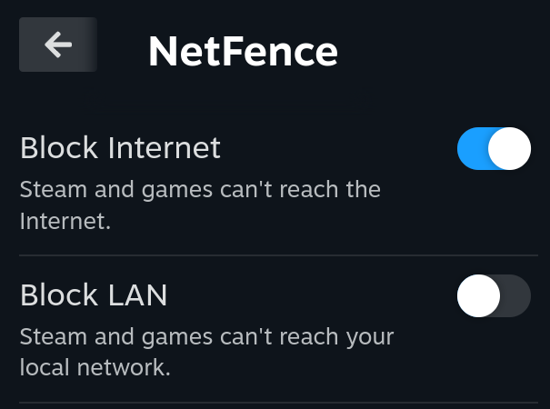
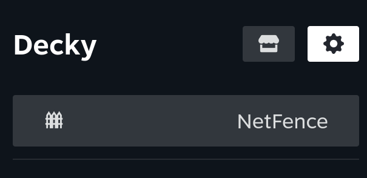
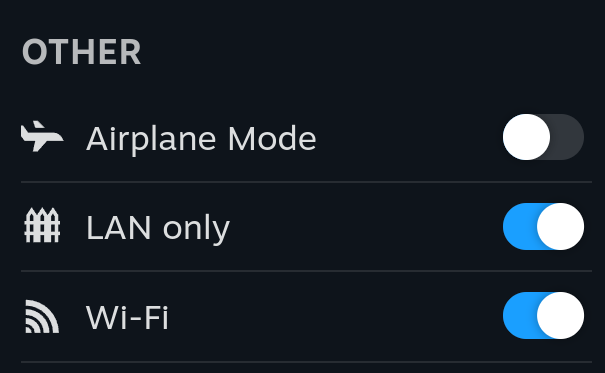
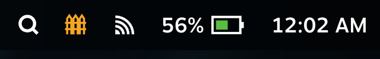

# NetFence

A [Decky Loader](https://github.com/SteamDeckHomebrew/decky-loader) plugin that lets you cut off **Internet** and/or **LAN** access for Steam and your games, instantly, from the Quick Access Menu. Works in Game Mode, no Steam restart required.

<p align="center">
  
  
</p>

## Features

- **Block Internet**: Steam and games can only talk to your local network. Great for LAN parties, keeping single-player games offline, or avoiding background updates while still using Remote Play and local transfers.
- **Block LAN**: Steam and games can't reach devices on your local network.
- **LAN only** toggle right in Steam's **Quick Settings**, under Airplane Mode.
- **Top bar indicator** while a block is active, so you never forget it's on.
- Both toggles apply **instantly**, no restart needed.
- Settings persist across reboots.
- Only Steam and games are affected; the rest of the system (Decky, system updates, Desktop Mode apps launched outside Steam) keeps normal network access.
- Loopback (`127.0.0.1`, `::1`) is never blocked.

<p align="center">
  
</p>
<p align="center">
  
</p>

## Installation

1. Download `NetFence.zip` from the [latest release](../../releases/latest).
2. In Game Mode, open **Quick Access Menu → Decky → Settings (gear) → Developer** and enable *Developer mode* if needed.
3. Choose **Install Plugin from ZIP** and select `NetFence.zip`.

## How it works

On SteamOS, the Steam client runs as `steam-launcher.service` and every game is started in its own systemd scope (`app-steam-app<APPID>-<N>.scope`), all under the user's `app.slice` cgroup.

NetFence's backend (running as root through Decky) installs an `nftables` table named `inet netfence` with an `output` chain that matches sockets by cgroup (`socket cgroupv2`) and rejects traffic from `app.slice` based on destination:

| Toggle | Rejected destinations |
| --- | --- |
| Block Internet | Anything outside the local ranges below |
| Block LAN | `10.0.0.0/8`, `172.16.0.0/12`, `192.168.0.0/16`, `169.254.0.0/16`, multicast, broadcast, `fe80::/10`, `fc00::/7`, `ff00::/8` |

Packets are rejected (not dropped), so Steam immediately notices it's offline instead of hanging on timeouts. A watcher re-applies the rules whenever the cgroup is recreated (e.g. after boot or a session restart).

No root filesystem changes are made, so it survives SteamOS updates.

## Caveats

- The Quick Settings toggle and top bar indicator hook into Steam's UI, which changes between client updates. If Steam changes, they fail silently and simply don't show up; the plugin panel always keeps working.

- In Desktop Mode, apps launched from the KDE menu also live under `app.slice`, so they're affected too while a toggle is on.
- Right after boot there can be a brief window before the rules are applied.

## Troubleshooting

Remove all NetFence rules manually:

```sh
sudo nft delete table inet netfence
```

Plugin logs are in `~/homebrew/logs/NetFence/`.

## Development

Requirements: Node.js 22+ and pnpm 9.

```sh
pnpm install
pnpm run build          # builds dist/index.js
./scripts/package.sh    # builds and packages out/NetFence.zip
```

Commits follow [Conventional Commits](https://www.conventionalcommits.org/). Every push to `main` runs [semantic-release](https://semantic-release.gitbook.io/), which bumps the version, generates release notes and publishes `NetFence.zip` as a GitHub release asset.

## License

[MIT](LICENSE)
